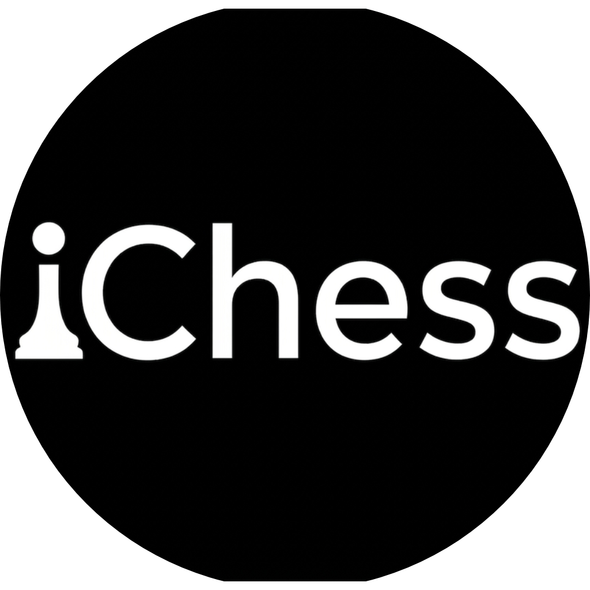

<p align="center">
  
</p>

<h1 align="center">iChess</h1>

<p align="center">
  <b>A real-time chess coach that lives inside the board you already play on.</b><br>
  Live engine lines, move classification, accuracy, and a coach that talks you through your game.
</p>

<p align="center">
  
  
  
  
  
</p>

<p align="center">
  <a href="#installation">Install</a> ·
  <a href="#coaches">Coaches</a> ·
  <a href="#settings">Settings</a> ·
  <a href="#pgn-analysis">PGN Analysis</a> ·
  <a href="#updating-ichess">Update</a> ·
  <a href="#how-it-works">How it works</a>
</p>

---

## Why

Playing online means your analysis lives in a different tab, your coach is a paywall, and
your game history is someone else's database. iChess puts the whole loop in one place:

- **Analysis runs locally.** Two WebAssembly engines ship with the extension. Nothing about
  your game is sent to a third-party analysis server.
- **The coach explains the move, not just the score.** Pick a persona and it reacts to the
  position you actually played — in 12 languages for the standard coaches.
- **It works on the sites you already use.** Chess.com, Lichess, and World Chess.

---

## Features

| | Feature | What it does |
|---|---|---|
| ♞ | **Three sites** | Full support for Chess.com, Lichess, and World Chess |
| ⚡ | **Dual WASM engines** | Komodo for lines and evaluation, Torch for coaching and classification |
| 🏆 | **Move classification** | `!!` `!` `★` `?!` `??` and book/forced markers drawn on the board |
| 📊 | **Accuracy widget** | Live accuracy % and estimated rating for both sides, draggable |
| 🗣️ | **Voice coaching** | The coach speaks its commentary, with optional subtitles |
| 📈 | **Evaluation bar** | Optional live eval bar pinned to the board |
| 🎚️ | **Depth control** | Engine depth from 1 to 15 — trade accuracy for speed |
| 🎨 | **Menu themes** | Dark and light, plus a retro/classic icon palette |
| 📥 | **PGN analysis** | Standalone analyser for any `.pgn` you paste or drop in |
| 🔔 | **Update checks** | Compares the local `manifest.json` against the remote one every 6 hours, shows a **NEW** badge and a one-time notification |

### Move classifications

Every move the coach engine returns is labelled:

`brilliant` · `great` · `best` · `excellent` · `good` · `book` · `forced` ·
`inaccuracy` · `mistake` · `miss` · `blunder`

---

## Installation

iChess is not on the Chrome Web Store — you load it unpacked from source. It has no build
step and no `npm install`.

**Requirements:** Chrome or Edge (Manifest V3), and roughly 250 MB of free disk for the
bundled engines.

```bash
# 1. Get the code
git clone https://github.com/ishatxt/ichess-coach.git
cd ichess-coach
```

2. Open `chrome://extensions/` in Chrome or Edge.
3. Turn on **Developer mode** (top-right toggle).
4. Click **Load unpacked**.
5. Select the cloned folder (the one containing `manifest.json`).
6. Pin iChess to your toolbar.

The first launch takes a few seconds while the ~41 MB of engine WASM is read from disk.

### Updating

Unpacked extensions can't update themselves. iChess shows a **NEW** toolbar badge and a
one-time notification when a newer version exists; you then update your own copy and reload it.
See [Updating iChess](#updating-ichess) for the steps.

---

## Updating iChess

iChess ships an update **notifier**, not an installer: it tells you when a newer version exists,
then you update your own copy. This is a deliberate limit of how Chrome treats unpacked
extensions (see [Why this can't install itself](#why-this-cant-install-itself)).

### How the checker works

The service worker downloads the repository's `manifest.json` over HTTPS:

```
https://raw.githubusercontent.com/ishatxt/ichess-coach/main/manifest.json
```

It reads **only** the `version` field and compares it numerically against
`chrome.runtime.getManifest().version` — so `1.10.0` is correctly treated as newer than `1.9.0`.
The response is treated as untrusted: non-2xx statuses, timeouts, malformed JSON, and invalid
version strings are rejected and logged with an `[iChess Updater]` prefix. An older or equal
remote version is never shown as an update, and a malformed version is never used at all.

No game data, PGNs, FENs, settings, or personal information is ever sent — the request only
reads version metadata. The remote JavaScript is never downloaded or executed.

### When it checks

- Immediately after install or browser startup.
- Then every **6 hours** via `chrome.alarms` (a single named alarm used only for the repeats, so
  restarts never reset or duplicate the schedule).
- Service-worker suspension and offline time are respected — a check simply runs late and
  retries on the next schedule, with no retry loops.

If you are offline or GitHub is unreachable, nothing happens and gameplay is unaffected.

### What the badge means

| Signal | Meaning |
|---|---|
| **`NEW`** toolbar badge (green) | A newer version exists. Hovering the icon shows the available and installed versions |
| Chrome notification with **View release** | Shown **once per version**; clicking it or the button opens the GitHub Releases page |
| Badge disappears | Your installed version is current (or newer) |

The last version you were notified about is stored separately, so you are never notified twice
about the same release. All existing settings under `chessConfig` are untouched.

### Updating an unpacked install

1. Wait for the **NEW** badge / notification (or just check the releases page).
2. Open the [latest release](https://github.com/ishatxt/ichess-coach/releases/latest).
3. Update your local copy — Git clone:
   ```bash
   git stash        # only if you have local modifications you want to keep
   git pull
   git stash pop    # restore them afterwards
   ```
   If `git pull` reports conflicting local changes, commit, stash, or discard them first.
   Not using Git? Download the new source and replace your folder, keeping it in the same place.
4. Open `chrome://extensions/`.
5. Click **Reload** on the iChess card.

Your coach selection, theme, engine depth, and every other setting live in
`chrome.storage.local` and survive the reload.

### Publishing a new version

1. Bump `version` in `manifest.json` (numeric — `3` → `4`, or `1.9.0` → `1.10.0`).
2. Commit and push to `main`.
3. Optionally create a GitHub Release with the changelog so "View release" lands on notes.

Installed users pick up the **NEW** badge within 6 hours, or on their next browser start.

### Why this can't install itself

An unpacked extension has no write access to its own installed source, and Chrome blocks
programmatic reload/installation outside the Web Store. This updater intentionally does not
download or execute remote code, disable developer-mode warnings, or change Chrome security
settings. Any tool claiming to silently auto-update an unpacked extension is bypassing the
browser — iChess does not.

### About authenticity

The checker compares **version strings only**. It does not verify signatures, checksums, or the
contents of a release, so a `NEW` badge alone is not proof that a release is safe or authentic.
Always review the source you pull.

### Chrome Web Store later

If iChess is published to the Chrome Web Store, installations from the store are updated
automatically by Chrome in the background — no pull, no reload. The notifier can then stay as a
fallback for people who keep loading the extension from source, so no code needs to be removed.

---

## Usage

1. Open **Chess.com**, **Lichess**, or **World Chess** and start a game.
2. Click the iChess toolbar icon (or press <kbd>=</kbd>) to open the menu.
3. Pick a **coach**.
4. Adjust the settings you care about — everything is saved automatically.
5. Play. The coach analyses each move and talks when there is something worth saying.

### Keyboard shortcuts

| Key | Action | Where |
|---|---|---|
| <kbd>=</kbd> | Open / close the coach menu | On the board pages |
| <kbd>Alt</kbd> + <kbd>C</kbd> | Toggle retro / classic icon colours | On the board pages |
| <kbd>←</kbd> <kbd>→</kbd> | Step through the game | PGN Analysis |
| <kbd>Home</kbd> / <kbd>End</kbd> | Jump to start / end | PGN Analysis |

---

## Coaches

### Standard — 4 coaches × 12 languages

Each standard coach speaks **English, French, Spanish, Arabic, Russian, Portuguese, German,
Italian, Turkish, Polish, Korean,** and **Indonesian**.

| Coach | Languages |
|---|---|
| **David** | 12 |
| **Mae** | 12 |
| **Dante** | 12 |
| **Nadia** | 12 |

### Celebrity — 12 coaches, English

Levy · Magnus · Hikaru · Anna · Canty · Anand · Tania · Danny · Botez · Ben · Sloane · Ruben

Coach personalities and their voice lines are loaded on demand from
`scripts/coach-assets/` and cached for the session, so switching coaches does not re-download
anything you have already used.

---

## Settings

| Setting | Default | Notes |
|---|---|---|
| **Coach** | None | Pick a personality, or `None` for engine-only analysis |
| **Engine Depth** | 10 | Range 1–15. Higher is more accurate and slower |
| **Move Classification** | Off | Draws `!!` / `??` style markers on the board |
| **Coach Voice** | Off | Speaks commentary as you play |
| **Coach Subtitles** | Off | Shows what the coach is saying |
| **Accuracy Widget** | On | Accuracy % and estimated rating per side |
| **Evaluation Bar** | Off | Live eval bar next to the board |
| **Menu Theme** | Dark | Toggle in the menu header |

Settings persist in `chrome.storage.local` under the `chessConfig` key. The accuracy widget
remembers where you dragged it. **Reset Defaults** in the menu footer restores the values above.

---

## PGN Analysis

A standalone analyser for finished games — no account, no upload.

Open it with **PGN Analysis** in the coach menu footer, then drop a `.pgn` file onto the page
or paste the moves directly.

It gives you:

- A replayable board with move navigation
- A live evaluation bar per ply
- Per-move classification and the full move list
- Accuracy and estimated rating for both sides
- A summary bar breaking down your game by move quality

Analysis runs on the bundled engines in your browser, so a full game takes a while and your
PGN never leaves your machine.

---

## How it works

```
   Chess.com  ─┐
   Lichess    ─┼─→  content scripts  ─→  WASM engines  ─→  DOM injection
   WorldChess ─┘         │                  (Workers)          │
                         │                                       │
                    service worker  ←──── messaging ────────────┘
                         │
        ┌────────────────┼──────────────────┐
   debugger API     offscreen audio      storage
   (move capture)   (coach voice)        (settings)
```

- **Move capture.** Chess.com exposes its game object, so the position is read directly. Lichess
  and World Chess keep their state inside closures, so the service worker attaches the Chrome
  debugger, finds the relevant handler in the site's own script, sets a breakpoint, and reads
  the position off the paused frame. Replaying a move is done by dispatching synthetic mouse
  events.
- **Analysis.** Komodo and Torch run in Web Workers created from blob URLs. Komodo handles
  MultiPV lines, evaluation, and the UCI strength/personality settings; Torch runs the coach
  engine, which returns the classification, accuracy, rating, and the speech payload for each
  move.
- **Voice.** Audio clips are fetched from Chess.com's `text-and-audio` service and proxied
  through the service worker as base64, because the board pages cannot fetch them directly.
- **Rendering.** Everything is plain DOM. The UI is injected into the host page so it inherits
  nothing from the site's framework.

---

## Project structure

```
ichess-coach/
├── manifest.json               # Manifest V3 definition
├── icons/                      # Toolbar icons (16 / 48 / 128)
├── pic/
│   └── iChess.jpeg             # Logo used in this README
├── engine/
│   ├── chess_min.js            # chess.js — move validation, FEN, PGN parsing
│   ├── komodo.js / .wasm       # Analysis engine (~16 MB)
│   └── torch.js / .wasm        # Coach + evaluation engine (~26 MB)
├── scripts/
│   ├── background.js           # Service worker: debugger capture, audio proxy, updates
│   ├── main.js                 # Bundled SweetAlert2 (legacy)
│   ├── core.js                 # Config, coach registry, classification icons
│   ├── core-engine.js          # Engine workers, menu UI, accuracy widget
│   ├── core-main.js            # Per-site board logic (Chess.com / Lichess / World Chess)
│   ├── sub-main.js             # Move replay helpers
│   └── coach-assets/           # Coach payloads (.json / .bzp) and avatars
├── chess-p/                    # Piece sprites for the PGN board
├── overlay/                    # Stream-mode board overlay
└── pgn/                        # Standalone PGN analysis page
```

---

## Tech stack

| Layer | Choice |
|---|---|
| Platform | Chrome Extension, Manifest V3 |
| Language | Vanilla JavaScript — no framework, no bundler |
| Engines | Komodo + Torch, compiled to WebAssembly |
| Rules | chess.js |
| Site integration | Chrome Debugger Protocol, content scripts |
| Audio | `Audio` + service-worker base64 proxy |
| Persistence | `chrome.storage.local` |
| UI | Hand-rolled DOM and CSS |

There is no `package.json`, no build step, and no runtime dependency to install. Clone, load,
play.

---

## Privacy

Your games are analysed **entirely on your machine**. The extension talks to:

| Host | Purpose |
|---|---|
| `chess.com`, `lichess.org`, `worldchess.com` | The pages you play on |
| `text-and-audio.chess.com` | Coach voice clips and coach text |
| `raw.githubusercontent.com` | Version check |
| `fonts.googleapis.com` | The Space Mono UI font |

The `debugger` permission is used only on Lichess and World Chess, and only to read the current
position — the same reason a screen reader needs accessibility access.

---

## Known limitations

- **Chrome and Edge only.** The debugger-based move capture has no Firefox equivalent.
- **Large download.** The engines are ~41 MB of WASM committed to the repository.
- **The debugger banner appears** on Lichess and World Chess while capture is attached.
- **PGN analysis is sequential.** A full game takes one engine call per ply, so long games
  are slow.
- **Celebrity coaches are English-only.** The 12-language set covers the four standard coaches.
- **Updates are manual.** The notifier only checks the version string in the repository's
  `manifest.json`; it cannot verify or install a release for an unpacked extension.
- `api.github.com` and `api.timezonedb.com` are declared in `host_permissions` but are not
  currently used by the code.

---

## Credits

- **Developer** — [ishatxt](https://github.com/ishatxt)
- **Community** — [Join the Discord](https://discord.gg/gVgn5Bn8d5)
- Coach personalities, classification, and voice lines originate from Chess.com's coaching
  engine and its `text-and-audio` service.

## License

No `LICENSE` file is included in this repository yet. Add one before distributing.

---

<p align="center">
  <sub>Built for people who want to know <em>why</em> they lost that game.</sub>
</p>
